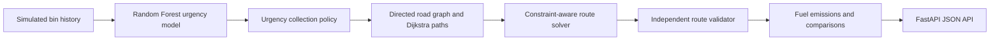

# EcoRoute AI backend prototype

EcoRoute AI is a backend-only prototype that generates simulated municipal-bin histories, predicts collection urgency, selects bins, and builds constraint-aware road-network routes. It exposes the workflow through FastAPI; no frontend or external map/API key is required.



## What is implemented

- Deterministic directed simulated road graph with non-negative road distances and travel times.
- Dijkstra paths, route expansion, capacity/distance/duration enforcement, and explicit unserved-bin reasons.
- Per-vehicle starting graph location and current load; routing uses remaining payload capacity and current simulated congestion-adjusted travel times.
- Per-bin assignment explanations with mock GPS coordinates, estimated arrival, post-pickup capacity, and alternative feasible insertion estimates.
- OR-Tools CVRP with Guided Local Search for each rolling-horizon planning snapshot; the named nearest-feasible heuristic is only a dependency fallback.
- An independent validator that reconstructs every route from graph edges; a route with missing required bins or a hard-constraint breach is `INFEASIBLE`.
- Reproducible synthetic bin histories, a chronological Random Forest evaluation split, and latest-observation urgency predictions.
- Estimated fuel and CO2 metrics, fixed-order same-stop comparison, and FastAPI endpoints.

The route engine uses OR-Tools CVRP with Guided Local Search. It produces a high-quality feasible solution under a bounded solve time, not a guarantee of global optimality. The formal behavior and limits are in [ROUTE_OPTIMIZATION_SPEC.md](ROUTE_OPTIMIZATION_SPEC.md).

## Installation and commands

Python 3.11+ is required. From PowerShell:

```powershell
python -m venv .venv
.\.venv\Scripts\Activate.ps1
python -m pip install -r requirements.txt
python -m pytest -q
python -m uvicorn app.main:app --reload
```

macOS/Linux:

```bash
python3 -m venv .venv
source .venv/bin/activate
python -m pip install -r requirements.txt
python -m pytest -q
python -m uvicorn app.main:app --reload
```

Open `http://127.0.0.1:8000/docs` to use the generated API documentation.

## Visual dashboard

For an interactive local dashboard, run this in a second terminal:

```powershell
python -m streamlit run dashboard.py
```

It opens a browser page where you can generate the synthetic data, train the model, view urgency predictions, choose the collection policy, optimize routes, and inspect independent validation results. It uses the same local project code and data files as the API.

To use Google Maps for the dashboard map, create `.env` by copying `.env.example`, then set `GOOGLE_MAPS_API_KEY` to a browser-restricted key with **Maps JavaScript API** and **Routes API** enabled. Keep the key out of version control. Google road geometry is requested only after you optimize a route; without a key, the dashboard shows its local fallback map.

After optimization, the map displays every active truck. Trucks with a route animate over Google road geometry; unused trucks remain visible beside the depot and are labelled with their full remaining capacity.

## API workflow

1. `POST /api/data/generate` with `{"bins":100,"days":30,"seed":42}`.
2. `POST /api/model/train`.
3. `POST /api/predictions/run`.
4. Send an explicit manifest and fleet to `POST /api/routes/optimize`.
5. Use `POST /api/routes/validate` to validate the returned route independently.
6. `POST /api/routes/compare` performs a transparent same-stop fixed-order comparison.
7. `POST /api/simulation/run` runs the fully synthetic pipeline and persists `experiments/latest_simulation.json`.

Example route request:

```json
{
  "depot": "n0_0",
  "stops": [{"bin_id": "BIN-001", "node": "n1_1", "demand_kg": 40, "urgency": "CRITICAL"}],
  "vehicles": [{"vehicle_id": "truck-1", "capacity_kg": 600, "current_load_kg": 120, "current_node": "n2_2", "max_duration_minutes": 480}],
  "traffic_multiplier": 1.4
}
```

`current_node` is a node in the simulated road graph (omit it to start at the depot). `current_load_kg` reduces the truck's remaining collection capacity. `traffic_multiplier` scales reproducible segment congestion estimates; it is a simulation control, not a live traffic feed. The solver minimizes estimated travel time and enforces capacity, distance, and duration limits.

The optimize response includes `assignment_explanations`. Each explanation shows the selected truck and route-start ETA, plus estimated added time and remaining capacity if the bin were inserted into each truck's planned route. These are local insertion comparisons for transparency; the selected assignments come from the joint fleet optimization, so the lowest standalone insertion estimate is not guaranteed to be the final choice.

## Assumptions and limitations

All coordinates, roads, observations, demand, vehicle states, traffic, fuel and emissions values are simulated estimates, not municipal measurements. The optimizer accepts graph-node vehicle locations and a caller-supplied traffic multiplier, but has no GPS ingestion or live traffic provider integration yet. Fuel assumes 32 L/100 km and 2.68 kg CO2/L. Demand may not be split between vehicles. Time windows are not yet enforced. The model uses synthetic data and therefore its reported metrics are diagnostic results for that simulation only, not field performance claims.
